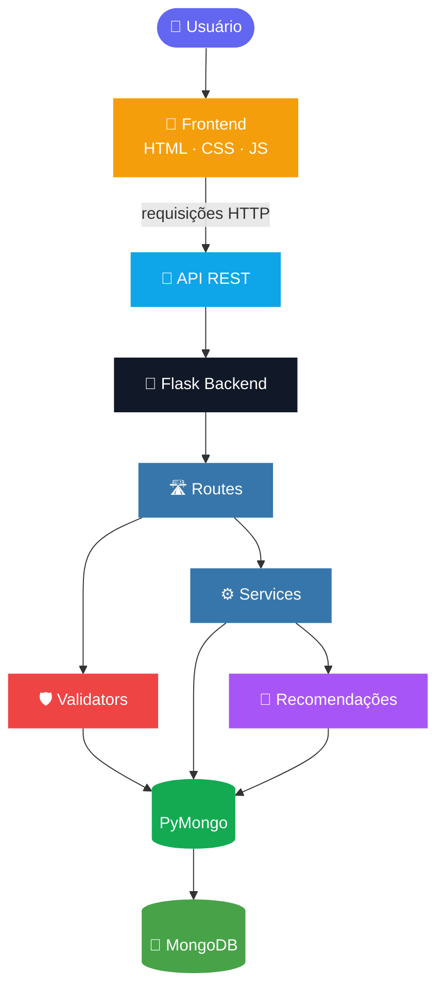
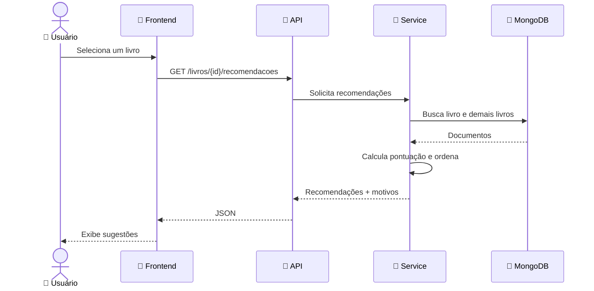

<div align="center">

# 📚 Biblioteca NoSQL

### Gerenciamento inteligente de acervo bibliográfico

*Python · Flask · MongoDB · Docker*

<br>


<br>

**Cadastre, consulte, edite e exclua livros, acompanhe indicadores do acervo<br>e receba recomendações de leitura baseadas no conteúdo dos livros.**

<br>

[Sobre](#-sobre-o-projeto) •
[Funcionalidades](#-funcionalidades) •
[Tecnologias](#️-tecnologias-utilizadas) •
[Arquitetura](#️-arquitetura-do-sistema) •
[Instalação](#️-instalação-e-configuração) •
[API](#-endpoints-da-api)

</div>

---

## 📌 Sumário

- [Sobre o projeto](#-sobre-o-projeto)
- [Objetivos](#-objetivos)
- [Funcionalidades](#-funcionalidades)
- [Tecnologias utilizadas](#️-tecnologias-utilizadas)
- [Arquitetura do sistema](#️-arquitetura-do-sistema)
- [Estrutura do projeto](#-estrutura-do-projeto)
- [Modelagem dos dados](#️-modelagem-dos-dados)
- [Sistema de recomendação](#-sistema-de-recomendação)
- [Pré-requisitos](#-pré-requisitos)
- [Instalação e configuração](#️-instalação-e-configuração)
- [Executando a aplicação](#️-executando-a-aplicação)
- [Endpoints da API](#-endpoints-da-api)
- [Validações e tratamento de erros](#️-validações-e-tratamento-de-erros)
- [Testes](#-testes)
- [Possíveis melhorias](#-possíveis-melhorias)
- [Autores](#-autores)
- [Licença](#-licença)

---

## 📖 Sobre o projeto

O **Biblioteca NoSQL** é uma aplicação web voltada ao gerenciamento de acervos bibliográficos.

A aplicação utiliza o **MongoDB** como sistema de gerenciamento de banco de dados, permitindo armazenar e manipular informações sobre livros por meio de documentos BSON.

O backend foi desenvolvido em **Python** com o framework **Flask**, responsável por disponibilizar uma **API REST** que realiza a comunicação entre a interface e o banco de dados.

O frontend utiliza tecnologias web tradicionais para apresentar os dados de maneira organizada e oferecer uma experiência intuitiva ao usuário.

Além das operações tradicionais de gerenciamento de dados (CRUD), o sistema possui um **mecanismo de recomendação de leitura** baseado nas características dos livros cadastrados.

> 🎓 Desenvolvido como projeto acadêmico para aplicação prática dos conceitos de bancos de dados NoSQL, integração entre aplicações e desenvolvimento de sistemas web.

---

## 🎯 Objetivos

| | Objetivo |
|:-:|---|
| 🍃 | Aplicar conceitos de bancos de dados NoSQL utilizando MongoDB. |
| 🔗 | Desenvolver uma aplicação integrada a um banco de dados não relacional. |
| 🔁 | Implementar operações CRUD por meio de uma API REST. |
| 🧱 | Organizar o backend utilizando separação de responsabilidades. |
| 🖥️ | Desenvolver uma interface web para interação com os dados. |
| 🧠 | Implementar um mecanismo de recomendação baseado em características dos livros. |
| 🔄 | Compreender a comunicação entre frontend, backend e banco de dados. |

---

## ✨ Funcionalidades

### 1️⃣ Gerenciamento de livros (CRUD)

O sistema disponibiliza as quatro operações fundamentais de manipulação de dados:

| Operação | Descrição |
|:-:|---|
| ➕ **Create** | Cadastrar novos livros no acervo. |
| 📖 **Read** | Consultar e listar os livros armazenados. |
| ✏️ **Update** | Editar informações de livros existentes. |
| 🗑️ **Delete** | Excluir livros do banco de dados. |

Cada livro possui as seguintes informações:

- 📕 Título
- ✍️ Autor
- 📅 Ano de publicação
- 🏷️ Gênero literário
- ✅ Disponibilidade para empréstimo

### 2️⃣ Catálogo de livros

A aplicação apresenta os livros cadastrados em uma tabela organizada, com:

- Título
- Autor
- Ano de publicação
- Gênero
- Situação de disponibilidade
- Ações de gerenciamento

### 3️⃣ Pesquisa de livros

O sistema permite pesquisar livros por:

- 🔎 Título
- 🔎 Autor
- 🔎 Gênero
- 🔎 Ano de publicação

> A filtragem acontece diretamente na interface, utilizando os dados carregados da API.

### 4️⃣ Dashboard administrativo

A interface possui um painel com indicadores do acervo:

| 📊 Indicador | Descrição |
|---|---|
| **Total** | Total de livros cadastrados. |
| **Disponíveis** | Quantidade de livros disponíveis. |
| **Emprestados** | Quantidade de livros emprestados. |

Os indicadores são atualizados conforme os dados do banco de dados.

### 5️⃣ Sistema de recomendação de leitura

O projeto possui um mecanismo de recomendação que identifica livros semelhantes a partir de suas características, utilizando a abordagem de **Content-Based Filtering (Filtragem Baseada em Conteúdo)**.

O sistema analisa os atributos dos livros e calcula uma pontuação de similaridade para identificar possíveis recomendações.

| Critério | Pontuação |
|---|:-:|
| 🏷️ Mesmo gênero literário | **+5 pontos** |
| ✍️ Mesmo autor | **+3 pontos** |
| 📅 Ano de publicação com diferença de até 10 anos | **+1 ponto** |

As recomendações são ordenadas pela pontuação obtida. Além da pontuação, o sistema apresenta **os motivos** pelos quais determinado livro foi recomendado.

<details>
<summary><b>💡 Ver exemplo prático</b></summary>

<br>

Considerando o livro *O Hobbit*, de J.R.R. Tolkien, o sistema identifica *O Senhor dos Anéis* como uma recomendação.

| Característica | Resultado |
|---|:-:|
| Mesmo gênero | +5 |
| Mesmo autor | +3 |
| **Pontuação total** | **8 pontos** |

O livro selecionado como referência não aparece na própria lista de recomendações.

</details>

---

## 🛠️ Tecnologias utilizadas

### 🐍 Backend

| Tecnologia | Utilização |
|---|---|
|  | Linguagem de programação do backend. |
|  | Framework para desenvolvimento da aplicação web e API REST. |
|  | Biblioteca de comunicação entre Python e MongoDB. |
|  | Formato utilizado pelo MongoDB para armazenamento de documentos. |

### 🍃 Banco de dados

| Tecnologia | Utilização |
|---|---|
|  | Banco de dados NoSQL orientado a documentos. |
|  | Containerização do banco de dados. |
|  | Gerenciamento da configuração e execução do container. |

### 🎨 Frontend

| Tecnologia | Utilização |
|---|---|
|  | Estrutura da interface. |
|  | Estilização e responsividade. |
|  | Interatividade e comunicação com a API. |
|  | Ícones da interface. |
|  | Tipografia da aplicação. |

---

## 🏗️ Arquitetura do sistema

A aplicação utiliza uma **arquitetura em camadas**, separando as responsabilidades de cada parte do sistema.



<details>
<summary><b>📝 Versão em texto do diagrama</b></summary>

```text
          USUÁRIO
             |
             v
      FRONTEND (HTML/CSS/JS)
             |
             v
         API REST
             |
             v
       FLASK (BACKEND)
             |
       +-----+-----+
       |           |
       v           v
    ROUTES      SERVICES
       |           |
       |           +------------------+
       |                              |
       v                              v
   VALIDATORS                 RECOMENDACOES
       |                              |
       +--------------+---------------+
                      |
                      v
                   PyMongo
                      |
                      v
                   MongoDB
```

</details>

### 🧩 Organização das responsabilidades

| Camada | Responsabilidade |
|---|---|
| 🛣️ **Routes** | Recebem as requisições HTTP, validam os parâmetros necessários e retornam as respostas da API. |
| ⚙️ **Services** | Concentram as regras de negócio e as operações relacionadas aos livros e às recomendações. |
| 🛡️ **Validators** | Realizam verificações dos dados recebidos antes de seu processamento. |
| 🗄️ **Database** | Centraliza a conexão com o MongoDB e disponibiliza a coleção utilizada pela aplicação. |
| 🎨 **Frontend** | Apresenta os dados e permite que o usuário interaja com as funcionalidades do sistema. |

---

## 📁 Estrutura do projeto

```text
Biblioteca/
│
├── 📂 backend/
│   │
│   ├── 📂 routes/
│   │   ├── __init__.py
│   │   └── livro_routes.py
│   │
│   ├── 📂 services/
│   │   ├── __init__.py
│   │   ├── livro_service.py
│   │   └── recomendacao_service.py
│   │
│   ├── 📂 validators/
│   │   ├── __init__.py
│   │   └── livro_validator.py
│   │
│   ├── __init__.py
│   └── database.py
│
├── 📂 static/
│   │
│   ├── 📂 css/
│   │   └── style.css
│   │
│   ├── 📂 images/
│   │
│   └── 📂 js/
│       └── app.js
│
├── 📂 templates/
│   └── index.html
│
├── app.py
├── compose.yaml
├── requirements.txt
└── run.py
```

<details>
<summary><b>📄 Descrição dos principais arquivos</b></summary>

<br>

| Arquivo | Responsabilidade |
|---|---|
| `backend/__init__.py` | Inicialização e configuração da aplicação Flask. |
| `backend/database.py` | Configuração da conexão com MongoDB. |
| `backend/routes/livro_routes.py` | Definição das rotas da API de livros. |
| `backend/services/livro_service.py` | Regras de negócio e operações CRUD. |
| `backend/services/recomendacao_service.py` | Processamento e classificação das recomendações. |
| `backend/validators/livro_validator.py` | Validação dos dados dos livros. |
| `templates/index.html` | Estrutura principal da interface. |
| `static/css/style.css` | Estilização da aplicação. |
| `static/js/app.js` | Comunicação com a API e funcionalidades da interface. |
| `compose.yaml` | Configuração do container MongoDB. |
| `requirements.txt` | Dependências Python do projeto. |
| `run.py` | Ponto de entrada para execução da aplicação. |

</details>

---

## 🗄️ Modelagem dos dados

O MongoDB utiliza uma estrutura orientada a documentos, permitindo armazenar os registros em formato BSON.

| | Nome |
|---|---|
| 🛢️ **Banco de dados** | `biblioteca` |
| 📚 **Coleção principal** | `livros` |

### Estrutura de um documento

```json
{
    "_id": "ObjectId",
    "titulo": "O Hobbit",
    "autor": "J.R.R. Tolkien",
    "ano": 1937,
    "genero": "Fantasia",
    "disponivel": true
}
```

### Descrição dos atributos

| Campo | Tipo | Descrição |
|---|:-:|---|
| `_id` | `ObjectId` | Identificador único gerado pelo MongoDB. |
| `titulo` | `String` | Título do livro. |
| `autor` | `String` | Nome do autor. |
| `ano` | `Integer` | Ano de publicação. |
| `genero` | `String` | Gênero literário. |
| `disponivel` | `Boolean` | Indica se o livro está disponível para empréstimo. |

> 💡 O MongoDB permite armazenar os documentos sem a necessidade de definir previamente uma estrutura rígida de tabelas e relacionamentos, como acontece em bancos de dados relacionais tradicionais.

---

## 🧠 Sistema de recomendação

O sistema de recomendação utiliza uma abordagem de **filtragem baseada em conteúdo** (*Content-Based Filtering*).

Diferentemente de sistemas colaborativos, que dependem de avaliações ou comportamentos de diferentes usuários, essa abordagem utiliza as **características dos próprios itens** para identificar semelhanças.

### 🔄 Funcionamento



1. O usuário seleciona um livro no catálogo.
2. O frontend solicita recomendações à API.
3. O backend identifica o livro selecionado.
4. O algoritmo compara suas características com os demais livros cadastrados.
5. Cada livro recebe uma pontuação de acordo com os critérios definidos.
6. Os livros com pontuação positiva são ordenados.
7. A API retorna os resultados ao frontend.
8. A interface apresenta as recomendações e os motivos de cada sugestão.

### 🧮 Algoritmo de pontuação

```text
pontuacao = 0

Se possuir o mesmo gênero:
    pontuacao += 5

Se possuir o mesmo autor:
    pontuacao += 3

Se a diferença entre os anos for menor ou igual a 10:
    pontuacao += 1
```

A pontuação final determina a ordem das recomendações.

> ⚠️ **Importante:** trata-se de um algoritmo de recomendação baseado em regras e características dos livros, não de um modelo de inteligência artificial treinado.

---

## 💻 Pré-requisitos

Antes de executar o projeto, é necessário possuir:

- [x] 🐍 Python 3.13 ou superior
- [x] 🐳 Docker Desktop
- [x] 🧩 Docker Compose
- [ ] 🌿 Git *(opcional, para clonar o repositório)*
- [x] 🌐 Navegador atualizado

> ℹ️ O Docker Desktop deve estar em execução para que o container do MongoDB possa ser iniciado.

---

## ⚙️ Instalação e configuração

### 1. Clonar o repositório

Caso o projeto esteja hospedado no GitHub:

```bash
git clone URL_DO_REPOSITORIO
```

Entre na pasta:

```bash
cd Biblioteca
```

### 2. Criar um ambiente virtual

No Windows:

```powershell
python -m venv .venv
```

Ative o ambiente virtual:

```powershell
.venv\Scripts\Activate.ps1
```

### 3. Instalar as dependências

Com o ambiente virtual ativado:

```powershell
pip install -r requirements.txt
```

O arquivo `requirements.txt` contém as dependências principais:

```text
Flask>=3.1,<4.0
pymongo>=4.10,<5.0
```

### 4. Iniciar o MongoDB

Certifique-se de que o Docker Desktop esteja em execução. Na raiz do projeto, execute:

```bash
docker compose up -d
```

Esse comando inicia o container configurado no arquivo `compose.yaml`. O MongoDB ficará disponível localmente na porta `27017`.

### 5. Verificar o container

Para verificar se o container está em execução:

```bash
docker ps
```

O container esperado é:

```text
biblioteca-mongodb
```

---

## ▶️ Executando a aplicação

Depois de instalar as dependências e iniciar o MongoDB, execute:

```bash
python run.py
```

O Flask iniciará o servidor local.

| 🌐 Recurso | Endereço |
|---|---|
| **Aplicação** | http://127.0.0.1:5000/ |
| **API de livros** | http://127.0.0.1:5000/livros |

Para encerrar a aplicação, pressione `Ctrl + C`.

Para interromper o container do MongoDB:

```bash
docker compose down
```

> 💾 **Observação:** os dados são armazenados em um volume Docker nomeado, configurado no Compose. Portanto, interromper o container com `docker compose down` não significa apagar os dados persistidos.

---

## 🔌 Endpoints da API

A aplicação disponibiliza endpoints REST para gerenciamento dos livros e geração de recomendações.

### 📚 Livros

| Método | Endpoint | Descrição |
|:-:|---|---|
|  | `/livros` | Lista os livros cadastrados. |
|  | `/livros` | Cadastra um novo livro. |
|  | `/livros/<id>` | Atualiza os dados de um livro. |
|  | `/livros/<id>` | Exclui um livro. |
|  | `/livros/<id>/recomendacoes` | Retorna recomendações relacionadas ao livro selecionado. |

### 📨 Exemplos de requisições

<details open>
<summary><b>Listar livros</b></summary>

```http
GET /livros
```

</details>

<details>
<summary><b>Cadastrar livro</b></summary>

```http
POST /livros
Content-Type: application/json
```

Corpo da requisição:

```json
{
    "titulo": "1984",
    "autor": "George Orwell",
    "ano": 1949,
    "genero": "Distopia",
    "disponivel": true
}
```

</details>

<details>
<summary><b>Atualizar livro</b></summary>

```http
PUT /livros/ID_DO_LIVRO
```

</details>

<details>
<summary><b>Excluir livro</b></summary>

```http
DELETE /livros/ID_DO_LIVRO
```

</details>

<details>
<summary><b>Consultar recomendações</b></summary>

```http
GET /livros/ID_DO_LIVRO/recomendacoes
```

</details>

### 🚦 Códigos HTTP

A API utiliza códigos de status HTTP para indicar o resultado das operações.

| Código | Significado |
|:-:|---|
| ✅ `200` | Requisição executada com sucesso. |
| 🆕 `201` | Recurso cadastrado com sucesso. |
| ⚠️ `400` | Requisição inválida ou dados incorretos. |
| 🔍 `404` | Livro não encontrado. |
| 🛑 `503` | Serviço temporariamente indisponível. |

---

## 🛡️ Validações e tratamento de erros

O projeto possui mecanismos de validação para evitar o armazenamento de informações inconsistentes.

Entre as verificações realizadas estão:

- ✔️ Preenchimento dos campos obrigatórios
- ✔️ Validação do ano de publicação
- ✔️ Verificação dos dados enviados pelo formulário
- ✔️ Validação dos identificadores dos documentos
- ✔️ Tratamento de livros não encontrados
- ✔️ Tratamento de falhas na comunicação com o banco de dados

O sistema também apresenta mensagens de retorno ao usuário para informar o resultado das operações.

---

## 🧪 Testes

Durante o desenvolvimento, foram realizadas verificações das principais funcionalidades da aplicação.

| Funcionalidade | Verificação |
|---|:-:|
| Conexão com MongoDB | ✅ Verificada |
| Inicialização do Flask | ✅ Verificada |
| Cadastro de livros | ✅ Testado |
| Listagem de livros | ✅ Testada |
| Atualização de livros | ✅ Testada |
| Exclusão de livros | ✅ Testada |
| Pesquisa no catálogo | ✅ Testada |
| Atualização dos indicadores | ✅ Testada |
| Validação do formulário | ✅ Testada |
| Recomendações por gênero | ✅ Testadas |
| Recomendações por autor | ✅ Testadas |
| Pontuação das recomendações | ✅ Testada |
| Exibição dos motivos das recomendações | ✅ Testada |

---

## 🚀 Possíveis melhorias

O projeto pode ser expandido com novas funcionalidades:

| | Melhoria | Descrição |
|:-:|---|---|
| 📈 | **Dashboard analítico** | Gráficos sobre distribuição de livros por gênero, autor e ano. |
| 🔍 | **Filtros avançados** | Pesquisa combinando diferentes atributos. |
| ⭐ | **Sistema de avaliações** | Permitir que leitores avaliem os livros. |
| 🔄 | **Histórico de empréstimos** | Registrar empréstimos e devoluções. |
| 🧠 | **Recomendações aprimoradas** | Considerar avaliações, preferências e histórico de leitura. |
| 📄 | **Paginação** | Melhorar a navegação em catálogos maiores. |
| 🔐 | **Autenticação** | Implementar contas e níveis de acesso. |
| 📤 | **Exportação de dados** | Permitir exportar informações do acervo. |
| 🧪 | **Testes automatizados** | Ampliar a cobertura de testes do backend e da API. |

---

## 👥 Autores

Projeto acadêmico desenvolvido como atividade prática de aplicação dos conceitos de bancos de dados NoSQL e desenvolvimento de sistemas web.

**Tecnologias principais:** `Python` · `Flask` · `MongoDB` · `Docker` · `HTML` · `CSS` · `JavaScript`

---

## 📄 Licença

Projeto desenvolvido para fins acadêmicos e educacionais.

<div align="center">

<br>

⭐ *Se este projeto foi útil para você, considere deixar uma estrela no repositório!* ⭐

</div>
